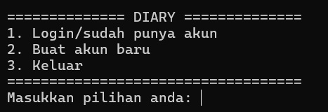
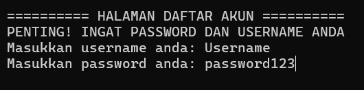
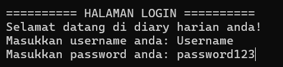
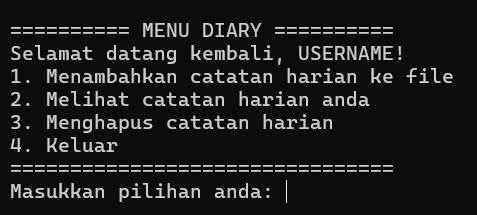
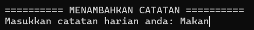
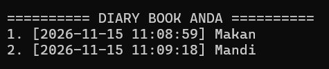
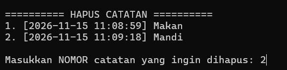

### :notebook: PENCATAT CATATAN HARIAN :snake:

---
**Aplikasi catatan harian (*diary*)** berbasis Command Line Interface (CLI) yang dibuat menggunakan Python. Program ini mendukung sistem registrasi dan login multi-pengguna, di mana setiap akun memiliki ruang penyimpanan catatan pribadinya masing-masing lengkap dengan pencatatan waktu otomatis (*timestamp*).

---
#### :sparkles: Fitur Utama

- **Sistem Multi-Akun (Registrasi & Login):** Pengguna dapat membuat akun baru dan masuk menggunakan username serta password yang tersimpan di `akun.txt`.
- **Penyimpanan Terpisah per Pengguna:** Catatan setiap akun disimpan secara otomatis ke dalam file terpisah (`catatan_<username>.txt`) sehingga privasi antar pengguna terjaga.
- **Timestamp Otomatis:** Setiap catatan baru yang ditambahkan otomatis dilengkapi dengan tanggal dan waktu pembuatan (`YYYY-MM-DD HH:MM:SS`).
- **Manajemen Catatan (CRUD Dasar):**
  - Menambahkan catatan harian baru.
  - Melihat seluruh daftar catatan harian secara berurutan.
  - Menghapus catatan spesifik berdasarkan nomor urut.

---
#### :gear: Cara Menjalankan Program
Pastikan komputer Anda sudah terinstal Python 3.8 atau yang lebih baru (dikembangkan menggunakan Python 3.12). Untuk menjalankan program ini, silahkan ikuti panduan berikut ini:

1. **Unduh kode program:**
```bash
git clone https://github.com/ardipuji/diary-cli.git
```

2. **Masuk ke folder proyek:**
```bash
cd diary-cli
```

3. **Jalankan program:**
```bash
python diary.py
```
atau
```bash
py diary.py
```
---
#### :camera_flash: Preview

1. **Halaman Autentikasi**


2. **Halaman Daftar Akun**


3. **Halaman Login**


4. **Menu Utama**


5. **Halaman Tambah Catatan**


6. **Halaman Lihat Catatan**


7. **Halaman Hapus Catatan**


---
#### :man_technologist: Author

Dikembangkan oleh **Ardi**

- :email: **Email:** [hardipuji19@email.com](mailto:hardipuji19@email.com)
- :link: **GitHub:** [@ardipuji](https://github.com/ardipuji)

---
*Terbuka untuk saran, masukan, maupun peluang kolaborasi!*
